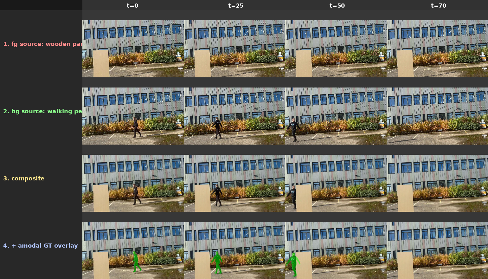

# Real-VAS

**A Real-World Video Amodal Segmentation Dataset — demo & evaluation code.**

Real-VAS is a zero-shot evaluation dataset for Video Amodal Segmentation,
built from composited real-world video with **programmatically exact amodal
ground truth**. This repo contains:

- A **demo pipeline** that produces modal + amodal ground-truth masks from a
  pair of input clips (or a single clip with named objects) — the same tool
  used to generate Real-VAS.
- An **evaluation harness** for scoring amodal-segmentation predictions
  against the Real-VAS benchmark on the Hub.

| | |
|---|---|
| 🤗 Dataset | [`fhudson96/Real-VAS`](https://huggingface.co/datasets/fhudson96/Real-VAS) |
| 🌐 Project page | https://finlay-hudson.github.io/real_vas |
| 📄 Paper | *under review* |

---

## Install

```bash
git clone https://github.com/finlay-hudson/Real-VAS.git
cd Real-VAS
python -m venv .venv && source .venv/bin/activate
pip install -e .
```

The demo also needs these upstream models (not available via PyPI):

```bash
pip install git+https://github.com/facebookresearch/sam2.git@2b90b9f
pip install git+https://github.com/luca-medeiros/lang-segment-anything.git --no-deps
```

Then download a SAM2 checkpoint (e.g. `sam2_hiera_large.pt`) from the SAM2
repository and keep its path handy — the demo takes it as `--sam-ckpt`.

### Optional: Gen-Omnimatte support

Modes that erase the FG object from the BG plate before compositing need the
`gen_omnimatte_tools` package (which vendors `omnimatte` and `videox_fun`).
It is **not shipped** with this repo because of its size and third-party
license surface. To enable Gen-Omnimatte modes:

1. Clone the upstream (or your own fork) of `gen_omnimatte_tools` into a
   directory of your choice.
2. Make it importable as `real_vas.utils.gen_omnimatte_tools`, e.g. via a
   symlink into this package or by adding it to `PYTHONPATH`.
3. Download the CogVideoX-Fun-V1.5-5b-InP checkpoint and the transformer
   weights, and pass their paths via `--gen-omnimatte-model-root` and
   `--gen-omnimatte-transformer`.

Without these, the two-clip minimal demo (below) still works end-to-end.

---

## Download the dataset

```python
from huggingface_hub import snapshot_download

local_dir = snapshot_download(
    repo_id="fhudson96/Real-VAS",
    repo_type="dataset",
    allow_patterns=["occlusion/**", "containment/**"],
)
```

The dataset is about 3 GB (300 occlusion + 100 containment clips). See the
dataset card for the per-clip layout.

---

## Quick demo

The shipped example (`outside_table_stationary_1` from Real-VAS) is a
**wooden panel** standing in a car park (fg occluder) composited over
another shot of the same scene where a **person walks past** (bg
occludee). The panel is static; the person walks right-to-left behind it.
Produces modal + amodal ground-truth masks for the walking person. Takes
~10 s on a single GPU, no LangSAM required (the shipped masks are the
exact per-object masks the dataset used to generate this clip).

```bash
export SAM_CKPT=/path/to/sam2_hiera_large.pt
bash scripts/run_demo.sh
```



*Row 1 — fg source clip (static wooden panel). Row 2 — bg source clip
(person walking right-to-left). Row 3 — composite (person walks behind the
panel). Row 4 — amodal GT overlay (green = where the person actually is,
even when hidden by the panel).*

Outputs land in `out/demo/`:

```
composite.mp4            # the panel-over-walker video
frames/00000.jpg ...     # per-frame composite
visible_masks/*.png      # modal masks (what the camera sees)
gt_masks/*.png           # amodal masks (walker tracked even behind the panel)
debugs/mask_overlays/    # red = fg, green = amodal mask
debugs/see_through_bg/   # composite + amodal overlay
```

### Run on your own clips

Two paths — give a text prompt (needs LangSAM installed) **or** supply a
first-frame mask PNG you drew yourself:

**With prompts (needs LangSAM):**
```bash
python -m real_vas.demo \
    --fg my_occluder.mp4 --fg-prompt "red ball" \
    --bg my_scene.mp4    --bg-prompt "person" \
    --sam-ckpt $SAM_CKPT \
    --out out/mine
```

**With pre-drawn first-frame masks (no LangSAM needed):**
```bash
python -m real_vas.demo \
    --fg my_occluder.mp4 --fg-mask-png my_occluder_frame0.png \
    --bg my_scene.mp4    --bg-mask-png my_scene_frame0.png \
    --sam-ckpt $SAM_CKPT \
    --out out/mine
```

### Optional: clean shadows with Gen-Omnimatte, or add camera motion

Add `--gen-omnimatte-model-root` + `--gen-omnimatte-transformer` for a clean
BG plate (see [Gen-Omnimatte setup](#optional-gen-omnimatte-support)), or
`--camera-motion pan_right` for virtual camera motion. Presets: `pan_left`,
`pan_right`, `pan_on_zoomed_canvas`, `dutch_angle_pan`, `zoom_in_tilt_down`,
`slow_zoom_and_pan_left`, `slow_zoom_and_pan_right`.

---

## Evaluation

Score your predictions against the Real-VAS dataset in one command:

```bash
python -m real_vas.evaluation.evaluate \
    --dataset ~/data/Real-VAS \
    --predictions ~/my_model_outputs/ \
    --split occlusion \
    --output results.json
```

The `predictions/` tree must mirror the dataset layout — one subdir per
video, PNG masks per frame:

```
predictions/
├── containment/<vid_name>/pred_masks/00000.png ...
└── occlusion/<vid_name>/pred_masks/00000.png ...
```

For multi-generation predictions, put each generation under `gen_0/`,
`gen_1/`, ... instead of `pred_masks/`. Masks can be grayscale PNG with any
value > 0 taken as foreground (or strictly 0/255).

Metrics per generation: `mIOU` (all frames), `mIOUfo` (any occlusion),
`mIOUffo` (fully occluded), `mIOUocc` (hidden-region IoU on
partially-occluded frames).

The underlying library is also available directly for custom harnesses:
`real_vas.evaluation.eval_runner.get_iou_results(preds, amodal_gt, modal_gt, occl_info)`.

---

## Repo layout

```
src/real_vas/
├── demo.py                   # end-to-end composite + GT mask generation
├── evaluation/               # scoring harness against the Real-VAS benchmark
│   ├── dataset.py            #   torch Dataset for Real-VAS clips
│   ├── eval_runner.py        #   IoU metrics (library)
│   └── utils.py              #   batch IoU helpers
└── utils/
    ├── segmentation_utils.py # LangSAM + SAM2 wrappers
    ├── video_loader.py       # decord-backed clip loader
    ├── vis_utils.py          # CompositeMaker + mask overlays
    ├── occlusion_utils.py    # modal/amodal → occlusion-level analysis
    ├── frame_utils.py        # resize / preprocess helpers
    ├── mask_utils.py         # RLE/bbox utilities
    ├── real_vas_occlusion_utils.py
    └── camera_motion_tools/  # virtual-camera-motion emulation
```

---

## Citation

```bibtex
@inproceedings{hudson2026realvas,
  title     = {Real-VAS: A Real-World Video Amodal Segmentation Dataset},
  author    = {Hudson, Finlay G. C. and Smith, William A. P.},
  booktitle = {Under review},
  year      = {2026}
}
```

---

## License

Code: **MIT** (see [LICENSE](LICENSE)).

The Real-VAS **dataset** on the Hugging Face Hub is released under
**CC-BY-NC-4.0** — see the [dataset card](https://huggingface.co/datasets/fhudson96/Real-VAS)
for details.
