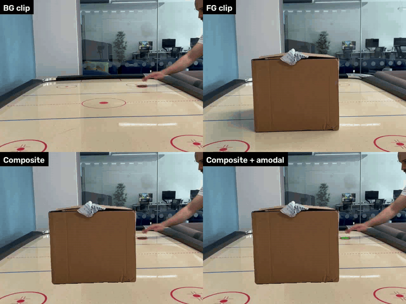
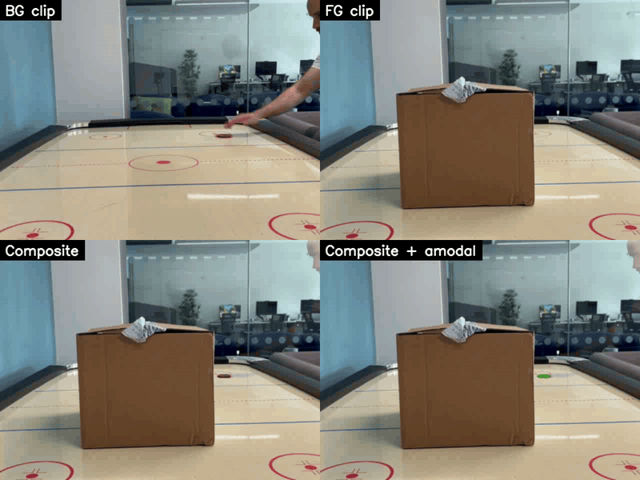

# Real-VAS

**A Real-World Video Amodal Segmentation Dataset — demo & evaluation code.**

Real-VAS is a zero-shot evaluation dataset for Video Amodal Segmentation,
built from composited real-world video with **programmatically exact amodal
ground truth**. This repo contains:

- A **demo pipeline** that produces modal + amodal ground-truth masks from a
  pair of input clips (or a single clip with named objects) — the same tool
  used to generate Real-VAS.
- An **evaluation harness** for scoring amodal-segmentation predictions
  against the Real-VAS benchmark on the Hub.

| | |
|---|---|
| 🤗 Dataset | [`fhudson96/Real-VAS`](https://huggingface.co/datasets/fhudson96/Real-VAS) |
| 🌐 Project page | https://finlay-hudson.github.io/real_vas |
| 📄 Paper | [arXiv:2611.00430](https://arxiv.org/abs/2611.00430) |

---

## Install

```bash
git clone https://github.com/finlay-hudson/Real-VAS.git
cd Real-VAS
python -m venv .venv && source .venv/bin/activate
pip install -e .
```

The demo also needs these upstream models (not available via PyPI):

```bash
pip install git+https://github.com/facebookresearch/sam2.git@2b90b9f
pip install git+https://github.com/luca-medeiros/lang-segment-anything.git --no-deps
```

Then download the SAM2-large checkpoint (~900 MB) and keep its path
handy — the demo takes it as `--sam-ckpt`:

```bash
wget https://dl.fbaipublicfiles.com/segment_anything_2/072824/sam2_hiera_large.pt
```

(This is the original SAM 2 checkpoint, matching the `sam2_hiera_l.yaml`
config the demo loads by default. Other sizes — tiny / small / base_plus
— live under the same `.../072824/` directory if you want a smaller
model.)

### Optional: Gen-Omnimatte support

Gen-Omnimatte extends the FG mask with the FG object's shadows and reflections
(by solving for the FG layer's alpha matte over the raw FG clip), so those
cues carry over naturally when the FG is composited onto the BG plate. It
needs the `gen_omnimatte_tools` package (which vendors `omnimatte` and
`videox_fun`) and is **not shipped** with this repo because of its size and
third-party license surface. To enable it:

1. Clone the upstream (or your own fork) of `gen_omnimatte_tools` into a
   directory of your choice.
2. Make it importable as `real_vas.utils.gen_omnimatte_tools`, e.g. via a
   symlink into this package or by adding it to `PYTHONPATH`.
3. Download the CogVideoX-Fun-V1.5-5b-InP checkpoint and the transformer
   weights, and pass their paths via `--gen-omnimatte-model-root` and
   `--gen-omnimatte-transformer`.

**Hardware:** CogVideoX-Fun is a 5.6 B parameter video diffusion model.
Measured peak ~42 GB VRAM on an A40 (longest edge 512, 27 frames) with
VAE slicing/tiling enabled. A GPU with **≥ 24 GB** is recommended; the
first-stage diffusion takes ~6 min on an A40. The headline two-clip demo
below needs **none** of this — it runs in ~10 s on any 8 GB GPU.

Without these, the two-clip minimal demo (below) still works end-to-end.

---

## Download the dataset

```python
from huggingface_hub import snapshot_download

local_dir = snapshot_download(
    repo_id="fhudson96/Real-VAS",
    repo_type="dataset",
    allow_patterns=["occlusion/**", "containment/**"],
)
print(local_dir)  # pass as --dataset to the evaluator
```

Or via the `huggingface-cli`:

```bash
huggingface-cli download fhudson96/Real-VAS --repo-type dataset \
    --include "occlusion/**" "containment/**" \
    --local-dir ~/data/Real-VAS
```

The dataset is about 3 GB (300 occlusion + 100 containment clips). Per
video:

```
<vid_name>/
├── amodal_masks/00000.png ...   # GT amodal masks (what the evaluator scores against)
├── modal_masks/00000.png  ...   # GT visible masks (used for hidden-region IoU)
├── frames/00000.jpg       ...   # source frames (eval doesn't read them)
├── annos.json                   # per-frame occlusion info
└── form.json                    # per-video metadata
```

To skip the source frames (eval doesn't read them, saves ~2 GB), tighten
the patterns to `["**/amodal_masks/**", "**/modal_masks/**", "**/*.json"]`.

---

## Quick demo

The shipped example is the air-hockey TTE pair from Real-VAS: a **cardboard
box** standing on the table (fg occluder, `examples/fg_box.mp4`) composited
over another shot of the same table where a **hand slides a puck across**
(bg occludee, `examples/bg_puck.mp4`). The box is static; the puck + hand
pass right-to-left behind it. Produces modal + amodal ground-truth masks
for the puck+hand. Takes ~10 s on any 8 GB+ GPU, no LangSAM or
Gen-Omnimatte required (the shipped PNGs are the exact per-object masks
the dataset uses).

```bash
export SAM_CKPT=/path/to/sam2_hiera_large.pt
bash scripts/run_demo.sh
```

See `examples/README.md` for what the shipped clips and masks are and
how they were captured.



*The shipped `out/demo/comparison.mp4` — four panels from left-to-right,
top-to-bottom: BG source clip (puck + hand), FG source clip (static box),
composite (box occludes puck + hand), composite + amodal GT overlay
(green = where the puck+hand actually is, including behind the box).*

Outputs land in `out/demo/`:

```
composite.mp4            # the panel-over-walker video
frames/00000.jpg ...     # per-frame composite
visible_masks/*.png      # modal masks (what the camera sees)
gt_masks/*.png           # amodal masks (walker tracked even behind the panel)
debugs/mask_overlays/    # red = fg, green = amodal mask
debugs/see_through_bg/   # composite + amodal overlay
```

### Run on your own clips

Two paths — give a text prompt (needs LangSAM installed) **or** supply a
first-frame mask PNG you drew yourself:

**With prompts (needs LangSAM):**
```bash
python -m real_vas.demo \
    --fg my_occluder.mp4 --fg-prompt "red ball" \
    --bg my_scene.mp4    --bg-prompt "person" \
    --sam-ckpt $SAM_CKPT \
    --out out/mine
```

**With pre-drawn first-frame masks (no LangSAM needed):**
```bash
python -m real_vas.demo \
    --fg my_occluder.mp4 --fg-mask-png my_occluder_frame0.png \
    --bg my_scene.mp4    --bg-mask-png my_scene_frame0.png \
    --sam-ckpt $SAM_CKPT \
    --out out/mine
```

### Optional: carry over shadows with Gen-Omnimatte, or add camera motion

Add `--gen-omnimatte-model-root` + `--gen-omnimatte-transformer` to extend
the FG mask with the FG object's shadows/reflections (see
[Gen-Omnimatte setup](#optional-gen-omnimatte-support)), or
`--camera-motion pan_right` for virtual camera motion. Presets: `pan_left`,
`pan_right`, `pan_on_zoomed_canvas`, `dutch_angle_pan`, `zoom_in_tilt_down`,
`slow_zoom_and_pan_left`, `slow_zoom_and_pan_right`.



*Same four-panel grid as above, with `--gen-omnimatte-model-root/...-transformer`
supplied. Gen-Omnimatte solves for the FG layer's alpha matte on the raw
FG clip, which pulls the box's **cast shadow** on the table into the FG
mask. In the composite (bottom-left panel) the box now casts its shadow
onto the puck+hand scene instead of appearing to float. Dials:
`--gen-omni-alpha-floor`, `--gen-omni-alpha-gamma`,
`--gen-omni-alpha-feather` — see `--help`.*

---

## Evaluation

Score your predictions against the Real-VAS dataset in one command:

```bash
python -m real_vas.evaluation.evaluate \
    --dataset ~/data/Real-VAS \
    --predictions ~/my_model_outputs/ \
    --split occlusion \
    --output results.json
```

Equivalent console entry point if you installed the package:
`real-vas-evaluate --dataset ... --predictions ... --split ...`

### Expected inputs

**`--dataset`** points at the Real-VAS root, exactly as it comes off the
Hub snapshot:

```
Real-VAS/
├── containment/<vid_name>/
│   ├── amodal_masks/00000.png ...   # GT amodal masks (what the eval scores against)
│   ├── modal_masks/00000.png  ...   # GT visible masks (used for hidden-region IoU)
│   ├── annos.json                   # per-frame occlusion info (level + amount)
│   ├── frames/00000.jpg ...         # source frames (optional; eval doesn't read them)
│   └── form.json, debug_vis/        # metadata (eval ignores)
└── occlusion/<vid_name>/
    └── (same layout)
```

The evaluator only reads `amodal_masks/`, `modal_masks/`, and `annos.json`,
so missing `frames/` is fine. `<vid_name>` is any string the dataset uses
— your predictions must match it exactly.

**`--predictions`** points at a tree that mirrors the dataset-split layout.
One directory per video, PNG per frame, filenames matching the GT masks:

```
predictions/
├── containment/<vid_name>/
│   └── pred_masks/
│       ├── 00000.png   # (H, W) grayscale, any value > 0 = foreground; or strictly 0/255
│       ├── 00001.png
│       └── ...         # one per GT frame, exact same shape as amodal_masks
└── occlusion/<vid_name>/
    └── pred_masks/
        └── ...
```

Rules the evaluator enforces:

- **Shape must match GT** — prediction `(T, H, W)` equals the dataset's
  `amodal_masks` shape. Resize before saving, or the eval errors out
  pointing at the mismatched video.
- **Frame count must match** — one PNG per GT frame, named so they sort
  the same way as the GT (zero-padded `00000.png`, `00001.png`, … works).
- **Grayscale PNG** — any pixel value `> 0` is foreground; strictly 0/255
  masks also work. The evaluator binarizes at 0.5.
- **Any directory name under `<vid_name>/`** — `pred_masks/`,
  `amodal_masks/`, or `predictions/` are all detected. Or put PNGs
  directly under `<vid_name>/` with no subdir.

**Multi-generation predictions** (stochastic or ensemble models): put each
generation in its own `gen_N/` directory next to (instead of) `pred_masks/`:

```
predictions/occlusion/<vid_name>/
├── gen_0/00000.png ...
├── gen_1/00000.png ...
└── gen_2/00000.png ...
```

The report then gives per-generation metrics (`gen: 0`, `gen: 1`, …).

**Videos with no prediction** are skipped with a warning and listed at the
end of the run; they don't fail the aggregate.

### Metrics

Each row/aggregate is per generation:

| Key       | Measured over                                         |
|-----------|-------------------------------------------------------|
| `mIOU`    | all frames (standard mask IoU vs. amodal GT)         |
| `mIOUfo`  | frames with any occlusion (`amount > 0`)             |
| `mIOUffo` | frames where the object is fully occluded            |
| `mIOUocc` | hidden-region IoU on partially-occluded frames: IoU of (pred ∧ ¬modal) vs. (amodal ∧ ¬modal) |

Empty buckets contribute no score to the aggregate: a video with no
fully-occluded frames returns NaN for `mIOUffo`, a video with no
partially-occluded frames returns NaN for `mIOUocc`. The CLI aggregates
with a `np.nanmean`-style rule — videos with NaN for a given metric are
dropped from both the numerator and the denominator for that metric
only. Counting them as zero would drag `mIOUffo` down roughly 3× against
most benchmarks; our CLI does not do that.

### End-to-end validation

Reproduced on the paper's Diffusion-VAS baseline predictions
(both splits, 398/400 videos; 2 skipped for annotation length mismatch):

| Metric   | Paper  | CLI    | Δ         |
|----------|--------|--------|-----------|
| mIOU     | 0.6988 | 0.6983 | −0.0005   |
| mIOUfo   | 0.6522 | 0.6523 | +0.0001   |
| mIOUffo  | 0.2017 | 0.2017 | ±0.0000   |
| mIOUocc  | 0.3907 | 0.3918 | +0.0011   |

### Programmatic use

The underlying library is callable directly for custom harnesses:

```python
from real_vas.evaluation.eval_runner import get_iou_results
results = get_iou_results(preds, amodal_gt, modal_gt, occl_info)
#  preds:      (G, T, H, W) uint8, 0 or 255 — G generations per video
#  amodal_gt:  (T, H, W) uint8 0/255
#  modal_gt:   (T, H, W) uint8 0/255
#  occl_info:  list[OcclusionInfo], one per frame (level, amount)
# Returns per-generation dict of {mIOU, mIOUffo, mIOUfo, mIOUocc};
# empty buckets return NaN — aggregate across videos with np.nanmean.
```

---

## Repo layout

```
src/real_vas/
├── demo.py                   # end-to-end composite + GT mask generation
├── evaluation/               # scoring harness against the Real-VAS benchmark
│   ├── dataset.py            #   torch Dataset for Real-VAS clips
│   ├── eval_runner.py        #   IoU metrics (library)
│   └── utils.py              #   batch IoU helpers
└── utils/
    ├── segmentation_utils.py # LangSAM + SAM2 wrappers
    ├── video_loader.py       # decord-backed clip loader
    ├── vis_utils.py          # CompositeMaker + mask overlays
    ├── occlusion_utils.py    # modal/amodal → occlusion-level analysis
    ├── frame_utils.py        # resize / preprocess helpers
    ├── mask_utils.py         # RLE/bbox utilities
    ├── real_vas_occlusion_utils.py
    └── camera_motion_tools/  # virtual-camera-motion emulation
```

---

## Citation

```bibtex
@article{hudson2026realvas,
  title         = {{Real-VAS}: A Real-World Video Amodal Segmentation Dataset},
  author        = {Hudson, Finlay G. C. and Smith, William A. P.},
  journal       = {arXiv preprint arXiv:2611.00430},
  year          = {2026},
  eprint        = {2611.00430},
  archivePrefix = {arXiv}
}
```

---

## License

Code: **MIT** (see [LICENSE](LICENSE)).

The Real-VAS **dataset** on the Hugging Face Hub is released under
**CC-BY-NC-4.0** — see the [dataset card](https://huggingface.co/datasets/fhudson96/Real-VAS)
for details.
